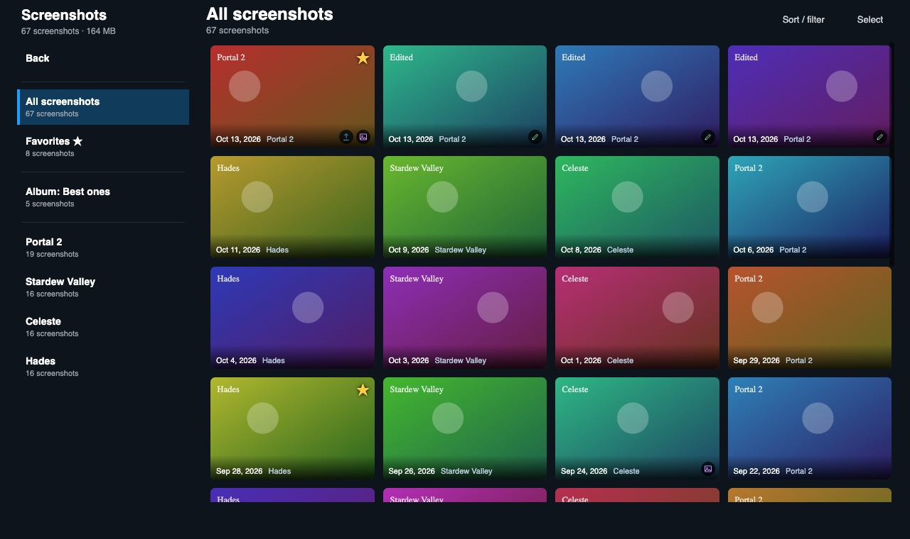
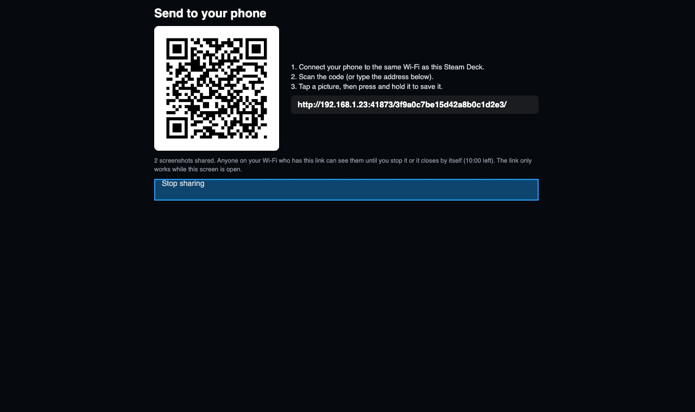

# Screenshot Gallery

**Browse, sort, group, edit and share your Steam screenshots from Gaming Mode on the Steam Deck.**



Screenshot Gallery reads the folders Steam already uses (`~/.local/share/Steam/userdata/<account id>/760/remote/<app id>/screenshots/`).
**Nothing in this plugin can delete or move a screenshot.**

- **Browse** by game or favorites, newest first, with a big viewer and L1 / R1 to move between pictures.
- **Sort and filter** by date, file size and game name, and **group into albums**.
- **Edit** (brightness, contrast, colour, rotate, crop) or **combine two screenshots** into one picture. Edited pictures also show up in the gallery.
- **Share as Screenshot** to the Steam Community with a caption, spoiler mark and privacy, the same way Steam's own Share dialog does.
- **Share as Artwork** attaches the picture to the game's artwork upload page for you.
- **Send to phone**: a QR code on the Deck opens your screenshots in your phone's browser over Wi-Fi. No cable needed.



*(Screenshots are from a desktop test version with made-up pictures.)*

## Install
No building needed: the release already contains the built plugin.

**From GitHub (easiest):** on the Deck, open Decky > Settings > Developer > turn on Developer mode, then choose "Install plugin from URL" and paste the link to
`Screenshot-Gallery.zip` from the latest [release](../../releases/latest). (Or download the zip, put it on the Deck, and use "Install plugin from ZIP file".)

**By hand:**
```
unzip Screenshot-Gallery.zip
sudo cp -r "Screenshot Gallery" ~/homebrew/plugins/ && sudo systemctl restart plugin_loader
```
If the panel says "couldn't start": `tail -n 30 ~/homebrew/logs/"Screenshot Gallery"/*.log`

## Gallery
Quick Access → Screenshot Gallery → **Open gallery**.
- Left: your games (names come from your Steam library; non-Steam games use the name Steam stored), with a **Back** button on top.
- Right: thumbnails, newest first. More load by themselves as you scroll to the end. In *All screenshots* and *Favorites*, each thumbnail also shows its game.
- Press A on a screenshot to open the viewer: the picture on the left, the actions on the right
  (**Favorite**, **Edit**, **Share as Screenshot**, **Share as Artwork**, **Send to phone**, **Add to album**, **Previous / Next**, **Close**).
- **Favorites** get their own list.
- Pictures you made in the editor now show up here too (with a small pencil icon), under the game they belong to.

## Sort and filter
**Sort / filter** (top right) opens a panel: sort by newest, oldest, largest, smallest or game; show only the last day, 7 or 30 days, or year;
show only small (under 1 MB), medium (1 to 3 MB) or large (over 3 MB) files; and a **Game name contains** box. It applies to the list you are in,
to **Select all**, and it is remembered while the gallery is open.

## Albums
Select screenshots (or open one) and press **Add to album**: pick an album or type a name for a new one. Albums are listed on the left.
In an album, **Remove from album** (select mode) takes screenshots out, and **Delete album** removes only the album: the screenshots are never touched.

## Send to phone
**Send to phone** (viewer, or select several) opens a small web page on your home network and shows a QR code. Scan it with your phone's camera
(same Wi-Fi), tap a picture and press and hold to save it, or tap **Save**. The page closes when you leave the screen, press **Stop sharing**,
or after 10 minutes. Anyone on the same Wi-Fi who has the link can see those screenshots while it is open; the link has a random part nobody can guess.

## Controls
- **A** opens a screenshot (or ticks it in select mode), **X** starts selecting (in the viewer, **X** stars the screenshot), **L1 / R1** move between screenshots in the viewer.
- **B** goes back one level at a time: editor, viewer, select mode, then out of the plugin.
- While the viewer or editor is open, the D-pad only moves between its own buttons.

## Share as Artwork
In the viewer, **Share as Artwork** copies the screenshot to `~/Pictures/Steam Screenshots/<game name>/`, opens that game's artwork upload page
(`steamcommunity.com/sharedfiles/edititem/<app id>/3/`) and **puts the picture into the page's file box for you** (Gaming Mode's browser can't open a
file picker). When the notification says "Picture attached", add a title, tick the "my own work" box and press Save and Continue.
If it can't attach (not signed in to Steam Community, slow page), a notification says why and where the file is.
This works through Steam's browser debugging port (8080, the one Decky itself uses).
- Steam limits artwork to 5 MB: a bigger screenshot is saved as a smaller JPEG copy first, and edited pictures are always kept under the limit.
- Non-Steam games have no Community Hub, so artwork can't be posted for them.
- Thumbnails show a small purple picture icon once a screenshot was sent to the artwork page (the plugin can't see whether you pressed Save there).

## Share as Screenshot (Steam Community)
**Share as Screenshot** asks Steam's own uploader to put the screenshot on the game's Community Hub. You can type a **caption** (up to 140
characters), mark it as a **spoiler**, and choose Public, Friends only, Unlisted or Private. It follows the same steps as Steam's own Share dialog (set the caption, set the spoiler mark, then upload), which were read from Steam's client code, but it has not been confirmed on a Steam Deck yet. If it fails, the
message says why, and **Save a report about this** (or **Check Steam sharing** in the Quick Access panel, which also tests the caption function without changing anything) writes `~/Downloads/screenshot-gallery-report.txt`
with what Steam answered, so it can be fixed. If a screenshot is already on Steam, the button turns grey and says so (Share as Artwork is unaffected). The caption box starts with the caption Steam already has. The first time you open a screenshot, the plugin quietly checks what Steam can do and saves a report to Downloads only if something is missing. Only screenshots Steam itself knows (taken with Steam + R1) and only Steam games can be uploaded this
way; pictures from the editor and non-Steam games can't. Steam's own screenshot manager always works as a fallback.

## Photo editor and combining two screenshots
- **Edit** (in the viewer, or select exactly one screenshot): brightness, contrast, colour, rotate, mirror and crop (16:9, 16:10, 4:3, square).
- **Combine** (select exactly two screenshots, then **Combine: top / bottom** or **Combine: side by side**): joins them into one picture.
  The first one you ticked goes on top / on the left; **Swap** reverses them, **Gap** adds a black gap between them.
- **Save a copy** writes a JPEG to `~/Pictures/Steam Screenshots/<game name>/Edited/`. The original screenshot is never changed.
- **Share edit as Artwork** saves the picture the same way, then opens the game's artwork page and attaches it.
- Edited pictures live in Pictures (Steam Screenshots/<game>/Edited) and also appear in this gallery. Screenshots over 12 MB can't be edited.

## Select several at once
Press **Select** (top right), or press **X** on a screenshot, then press A on screenshots to tick them.
- **Select all N** ticks every screenshot in the current view, even ones on pages you haven't loaded; **Select none** clears it.
- **Star / Un-star** and **Copy to Pictures** (an organized copy of just those). Changing game or filter clears the selection. **Done** leaves select mode.

## Tools (Quick Access panel)
- **Export an organized copy:** copies every screenshot to `~/Pictures/Steam Screenshots/<game name>/<date time>.jpg`. Nothing is moved; safe to run again.
- **Check folders:** shows where Steam's screenshots were found. Use it if the gallery looks empty.

## Good to know
- Screenshots over 5 MB are shown as their thumbnail in the viewer. Only JPG and PNG files are listed.
- Screenshots Steam saves to a custom "uncompressed copy" folder are not included.
- The plugin never edits Steam's own index (`screenshots.vdf`).

## For developers
`dist/index.js` is committed, so users never build. To change the plugin: edit `src/`, run `pnpm i && pnpm build`, commit `dist/`, and see `RELEASING.md`.
Backend test: `python3 -I tests/test_backend.py`.
